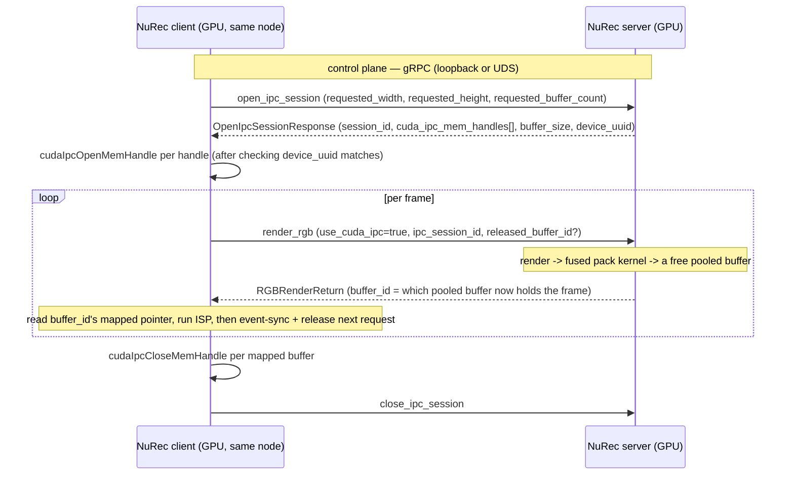

<!--
SPDX-FileCopyrightText: Copyright (c) 2026 NVIDIA CORPORATION & AFFILIATES. All rights reserved.
SPDX-License-Identifier: Apache-2.0
-->

# NuRec CUDA IPC transport (same-node frame delivery)

This folder implements an optional **CUDA IPC** transport for the `serve-grpc`
render service, for the common case where the client runs on the **same node** as
the server. It shares GPU memory across the two processes with `cudaIpcGetMemHandle`
/ `cudaIpcOpenMemHandle`, so no NIC and no host round-trip are needed — just PCIe.

## Motivation

CUDA IPC lets one process hand another process a pointer to the _same_ physical GPU
memory it already rendered into, with no copy at all. It uses the shared fused pack
kernel (`//nurec/libs/render_pack:render_pack_cuda`) to convert the renderer's raw float
output directly into the delivered format in the buffer the client maps.

## Architecture — ownership and buffer pool

**The server owns the buffers**: at session open it pre-allocates a small pool (default 2, i.e.
double-buffered) and exports each as a `cudaIpcMemHandle_t`. The client only ever
reads. `render_rgb` stays a blocking RPC; buffer selection is entirely server-side —
the client's only input is telling the server, via `released_buffer_id` on its
_next_ request, that it is done reading a buffer from a previous response (having
already fenced that release with its own CPU-side `cudaEventSynchronize`, so no new
CUDA event plumbing is needed on the server side for this).



**Same-GPU requirement:** the client's `device_uuid` check (against
`OpenIpcSessionResponse.device_uuid`, `cudaDeviceProp::uuid`) guards against opening
handles exported by a different physical GPU than the one the client's CUDA context
is bound to — `cudaIpcOpenMemHandle` only works within the same GPU.

**Teardown order:** the client must call `cudaIpcCloseMemHandle` on every buffer it
mapped _before_ sending `close_ipc_session` — `close_session` (`cuda_ipc_module.cpp`)
`cudaFree`s the underlying allocations as soon as it receives the request, and CUDA
documents that freeing memory an importer still has open is undefined behavior. This
is entirely a client-side ordering requirement; the server has no way to detect or
enforce it (it doesn't know whether the client has actually closed its mappings).

## gRPC additions (session protocol)

- **`ipc.proto`** — new package `nurec.grpc.protos.ipc`, two request/response pairs:
  - `OpenIpcSession{Request,Response}` — client requests a frame size and buffer
    count; server allocates the pool and returns one `cudaIpcMemHandle_t` per buffer
    plus `buffer_size` and its `device_uuid`. No `RegisterReceiveBuffer` analog —
    there is nothing for the client to register, since the server owns every buffer.
  - `CloseIpcSession{Request,Response}` — best-effort teardown.
- **`sensorsim.proto`** imports `ipc.proto`, adds the two RPCs (`open_ipc_session`,
  `close_ipc_session`), and gives both `RGBRenderRequest` (tags 21/22/23) and
  `CameraRenderRequest` (tags 18/19/20) the same opt-in fields: `use_cuda_ipc`,
  `ipc_session_id`, `released_buffer_id`. `RGBRenderReturn` gets `format` (tag 2)
  and `buffer_id` (tag 3); `CameraRenderOutput` gets the same pair at tags 7/8 —
  in both cases the server-selected buffer that now holds the frame.
  `CameraRenderRequest`'s IPC path only ever produces a single
  `CAMERA_RENDER_PRODUCT_COLOR` output (no bounding-box overlay, no second product):
  the pack kernel writes straight from the float32 raster, with no host-visible
  image for an overlay to draw onto or a second, differently-typed buffer.

## Components

| File                  | Role                                                                                                                                                                          |
| --------------------- | ----------------------------------------------------------------------------------------------------------------------------------------------------------------------------- |
| `cuda_ipc_module.cpp` | pybind11 `IpcManager` — owns the per-session buffer pool; `open_session` / `write_render_hwc_f32` / `close_session`. The entire native surface — no network handshake needed. |
| `__init__.py`         | exposes `IpcManager` (or `None` when the native module is not built).                                                                                                         |

`write_render_hwc_f32` reuses `nurec_render_pack::launch_render_pack_hwc_f32_to_chw_u8`
from `//nurec/libs/render_pack:render_pack_cuda` directly — no kernel duplication.

Server-side wiring lives in `nurec/grpc/serve.py`: `open_ipc_session` /
`close_ipc_session` handlers, and the `use_cuda_ipc` branch in `render_rgb` and
`render_camera` (and, for batches of `RGBRenderRequest` items, `batch_render_rgb`)
that calls `IpcManager.write_render_hwc_f32`.

## Build

The transport is always built in — no opt-in flag:

```bash
bazel build //:run
```

`serve.py`'s import of `IpcManager` still degrades gracefully (defensive
try/except) if it were ever to fail, so a build that somehow lacked the native
module would start normally and report the IPC RPCs as unavailable.

## Runtime requirements

- Client and server processes on the same node, sharing the same physical GPU
  (verified via `device_uuid`).
- On DGX Spark (unified host/device memory, `aarch64`), establishing a _new_ process's first
  CUDA context can transiently fail with `cudaErrorMemoryAllocation` ("out of memory") or
  "busy or unavailable" if a parallel Bazel build is starving the 2 MiB-contiguous pages a
  primary context needs — the same race `nurec/grpc/model_owner_test.py`'s
  `_CUDA_IPC_WORKER_SRC` retries around for its own bare-interpreter worker.
  `cuda_ipc_transport_test.py`'s cross-process test retries its child's `cudaSetDevice` for up
  to 60s on `aarch64` for the same reason; a real client hitting this should retry similarly
  rather than treat it as a hard failure.
- `NRE_CUDA_IPC_DEVICE` may pin which CUDA device index the server opens; defaults
  to device 0.
- Buffers are fixed-size for the life of a session (sized from
  `OpenIpcSessionRequest.requested_width/height` at open time) — a client that wants
  to change render resolution must close and reopen the session.
- **No authentication beyond "same node, reaches the gRPC endpoint":** any co-located
  process that can call `open_ipc_session` gets `cudaIpcMemHandle_t`s mapping GPU
  memory it can then read/write directly — a broader capability than the encoded-bytes
  `render_rgb` response already exposed. There is no per-client identity or authorization
  check, so this transport assumes every co-located process is trusted. Session ids are
  128 bits of random entropy (not a sequential counter) specifically so that one
  co-located process cannot guess another's session id and close it or release/overwrite
  buffers it is still reading — but a session id is still the _only_ capability check any
  session-scoped operation makes, so possession of it (e.g. read off another process via
  some other channel) is equivalent to ownership.
- **GPU memory caps:** `requested_width`/`requested_height`/`requested_buffer_count` are
  bounded per-request server-side (native `IpcManager::open_session`); concurrent sessions
  are capped (`NRE_CUDA_IPC_MAX_SESSIONS`, default 32); and the aggregate byte footprint of
  every currently-open session is capped (`NRE_CUDA_IPC_MAX_TOTAL_BYTES`, default 16 GiB) —
  a session count cap alone doesn't bound memory, since a single session can already
  request up to `--cuda-ipc-max-buffer-count` buffers at up to the maximum resolution.

## Testing

```bash
# proto wire tags (no hardware)
bazel test //nurec/grpc/protos:ipc_proto_test

# buffer-pool lifecycle + cross-process IPC handle roundtrip (needs a GPU)
bazel test //nurec/libs/cuda_ipc_transport:cuda_ipc_transport_test
```

Full end-to-end verification against the real `nurec-directdisplay` client is a
manual smoke test, not run in CI.
