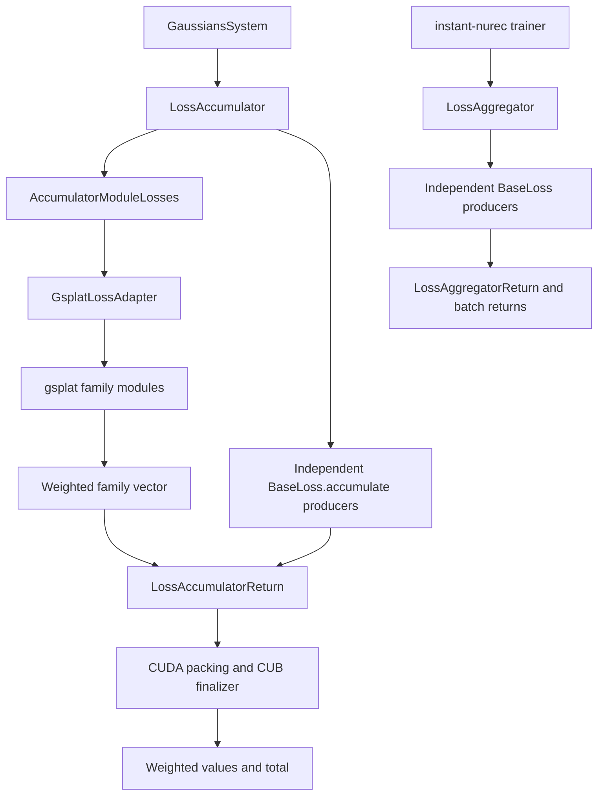

<!--
SPDX-FileCopyrightText: Copyright (c) 2026 NVIDIA CORPORATION & AFFILIATES. All rights reserved.
SPDX-License-Identifier: Apache-2.0
-->

# Losses

NuRec selects and schedules losses, gathers model and dataset inputs, and combines
their results. Gsplat implements fused CUDA loss families and their gradients.

## Architecture

| Layer                | Owner                                                       | Responsibility                                                   |
| -------------------- | ----------------------------------------------------------- | ---------------------------------------------------------------- |
| 3: orchestration     | `LossAccumulator` / `LossAggregator`                        | Configuration, producer lifecycle and result packaging           |
| 2: model inputs      | `AccumulatorModuleLosses` / individual `BaseLoss` producers | Scheduling, data availability and model-specific input selection |
| 1: tensor adaptation | `GsplatLossAdapter`                                         | NRE layouts, gsplat modules and configuration caches             |
| 0: loss computation  | gsplat                                                      | Family loss mathematics, reduction and autograd                  |

Gaussian training uses `LossAccumulator`; instant-nurec training uses `LossAggregator`.
Both implement `LossOrchestrator` and are called through `self.loss(...)`.
Their initialization and training-step callbacks share helpers in
`orchestration/loss_producers.py`.

## Accumulator path

### Model inputs

`models/accumulator_module.py` owns `AccumulatorModuleLosses`. It selects
scheduled losses and snapshots their current signed outer weights. The twenty
canonical slots are defined by `ACCUMULATOR_LOSS_NAMES` and `LOSS_SLOT_BY_NAME`
in `functional/cuda_losses_accumulator.py`.

`AccumulatorModuleLosses.accumulate(step, model, results, target)`:

1. Checks data availability for the configured members.
2. Creates a zero-initialized float32 CUDA vector.
3. Calls the camera, SSIM, LiDAR, Gaussian, BgGrid, BgTrack/node-semantic and
   Ground group methods, rebinding the vector returned by each active family.
4. Returns the weighted vector and its reporting weights.

The helpers in `models/fused_loss_inputs.py` gather Gaussian visibility,
background/track tensors and semantic domains. Scale and density preparation
share segment collection while retaining node storage, zero-weight offsets and
active empty inputs.

A nonzero outer weight requires computation, including negative weights.
Disabled inputs are `None`; enabled but empty domains keep their tensors and
connections to autograd. Shared camera/LiDAR flags are required whenever an
active member uses them. Configured reporting values follow each member's data
availability and zero-weight rules.

### Tensor adaptation

`functional/cuda_losses_accumulator.py` implements `GsplatLossAdapter`, a
registered submodule of `AccumulatorModuleLosses`. It owns Camera, LiDAR and
BgGrid modules and configuration-keyed caches for Gaussian, BgTrack/node-semantic,
SSIM and Ground modules.

Each family method receives selected tensors, weights and metadata. The adapter
checks NRE layouts before reshaping or indexing, chooses bounded or flat Gaussian
inputs, constructs `JointSemantics` or `PackedSemantics`, and calls its gsplat
module. Gsplat validates its tensor contract and normalizes contiguity.

The adapter preserves Gaussian deformation broadcasting and supplies BgGrid's
common `1 / (Nc + Nf)` drift factor for camera/frame grid cells. BgTrack semantic
inputs are detached before gsplat dispatch. SSIM with semantic weights or a
window size other than eleven is computed by its independent producer.

Ground occupies slot 19. Its inputs are road positions, raw wxyz rotations,
the first camera pose and one set of random offsets per active call. Position
and rotation inputs receive gradients; pose and offsets are nondifferentiable.
Camera metadata is validated before sampling. Missing road/camera inputs and
zero outer weights skip sampling. Ground uses the fused route only when its
rotation coefficient is zero or lies between float32 epsilon and float32 maximum;
other coefficients use the independent producer's absolute-value epilogue.

Family methods run in the caller's gradient mode. Do not put gsplat module calls
inside another `torch.autograd.Function.forward` or unconditional `no_grad`:
that would discard the graph connecting family results to model inputs.

### Independent producers

`LossAccumulator.__call__()` combines the family vector with independent
producers. Shared argument preparation supplies render or instant-nurec primitive inputs
to `BaseLoss.accumulate()`.

A producer can override `accumulate()` to return `AccumulatorLoss` containing a
value, reduction and outer weight. PPISP publishes its regularization scalar this
way. The default implementation invokes the independent producer and publishes
its reduced, already-weighted scalar with finalizer weight one; reporting metadata
retains the configured outer weight. This applies objective weights exactly once.

Consumers append scalar losses, including calibration, through
`append_loss(name=..., value=..., weight=...)`. Appended scalars are unweighted
and receive their outer weight during finalization.

### Results and finalization

`LossAccumulatorReturn` in `orchestration/config.py` holds the weighted family
prefix and independent `AccumulatorLoss` inputs. Independent values follow in
producer order. `names` and `weights_by_name` identify the reported losses.

The first `compute_total()`, `weighted_values` or `log()` call reduces pending
independent values and invokes `finalize_accumulated_losses()` from
`nurec/libs/loss_aggregation_ops`. The CUDA extension takes one contiguous
float32 weighted vector and independently weighted scalar tensors. It returns
a float32 total and `weighted_values`, which packs the prefix followed by the
weighted scalars. Both outputs support first-order backward.

CUB performs the total reduction. Up to sixteen descriptors, counting the prefix
and independent scalars, are passed inline and support CUDA graph capture.
Larger eager inputs upload descriptors sized for the call. A scalar with exact
zero weight is not read and receives an exact zero gradient.

Finalization is cached while preserving later gradients after reads under
`no_grad` or inference mode. Metadata access through `names` and
`weighted_value_dtype(name)` does not force finalization. Logging records weighted
values under `loss/<name>` and configured weights under `train_params/<name>_lambda`.
`backward_roots()` provides named autograd roots for optional profiling.

`BaseSystem` consumes `compute_total()` within its coordinated forward error
boundary and passes the same tensor to backward. Gaussian training applies
component-only camera rescaling through the result interface before appending
calibration. Per-loss logging runs when its logger is enabled.

## Independent aggregate path

`orchestration/loss_aggregator.py` implements `LossAggregator`. It constructs and
runs individual registered producers and returns `LossAggregatorReturn`.
Render producers receive model/rendering/target inputs; primitive producers
receive instant-nurec primitive, supervision and context inputs. Each producer handles
its loss function, reduction and weight.

`LossReturn` contains each reduced weighted loss. `LossAggregatorReturn` combines
those results; `LossAggregatorBatchReturn` averages sample results and includes
shared scalars outside that sample mean. Their `reduce()` and `total_value` APIs
serve independent aggregate consumers.

The `LossResult` protocol covers `compute_total()`, logging, scalar appending,
rescaling, named metadata and backward roots across result implementations.
Consumers use this interface without result-type dispatch.

## Adding a loss

Register individual producers with `@register_loss(name)` and derive from
`BaseRenderLoss` or `BasePrimitiveLoss`. Names follow
`{loss_name}_{loss_fn}_{reduce_fn}`. Configuration selects the function,
reduction, outer weight, start step and optional lambda scheduler.

For a fused family member, add its slot and tensor adaptation to the appropriate
`GsplatLossAdapter` method and select its model inputs in `AccumulatorModuleLosses`.
Keep scheduling, disabled and empty inputs, signed weights and gradient contracts
consistent. Loss mathematics and native reductions belong in gsplat.

Verify values and gradients against the independent producer, including absent
inputs, zero/negative weights, noncontiguous tensors and logging before backward.
The runnable examples are in `examples/example_losses.py`.
