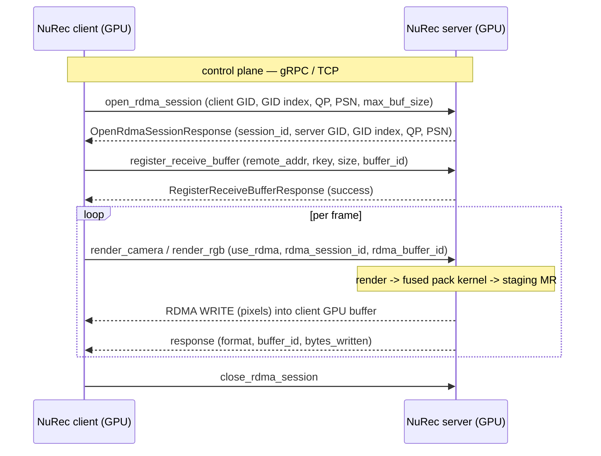

<!--
SPDX-FileCopyrightText: Copyright (c) 2025-2026 NVIDIA CORPORATION & AFFILIATES. All rights reserved.
SPDX-License-Identifier: Apache-2.0
-->

# NuRec RDMA transport (GPUDirect frame delivery)

This folder implements an optional **RDMA WRITE** transport for the `serve-grpc`
render service. When a client opts in, the server delivers the rendered RGB frame
**directly into the client's GPU memory** over RoCE v2, bypassing the gRPC image
payload entirely. It is built for the hardware-in-the-loop (HIL) use case:
predictable, sub-frame latency for 8–10 cameras at 30 fps, with payloads of tens
of MiB per frame. For a client on the **same node**, the CUDA IPC transport
(`nurec/libs/cuda_ipc_transport`) needs no NIC at all.

## Motivation

The stock gRPC path moves each frame through several copies and a codec:

```
render (server GPU) -> D2H copy -> JPEG/PNG encode -> gRPC protobuf bytes
                    -> TCP -> client decode -> H2D upload
```

Every stage costs milliseconds and memory bandwidth, and the encode/decode
dominates at 4K camera resolutions. The RDMA path keeps the raw rendered tensor on
the GPU and ships the pixel bytes straight to the consumer via GPUDirect — no
encode, no decode, no host round-trip. Raw frames are much larger than compressed
JPEG/PNG, which is exactly why RDMA (not TCP) is used for the data plane.

## Architecture — control plane vs data plane

- **Control plane — gRPC over TCP.** Session lifecycle and the per-frame render
  request/response. On RDMA frames the response carries **metadata only**
  (`format`, `buffer_id`, `bytes_written`); `image_bytes` is left empty.
- **Data plane — RDMA WRITE over RoCE v2.** The server NIC writes the pixel bytes
  directly into the client's pre-registered GPU buffer.



**GPUDirect requirement:** both endpoints place the NIC and the GPU on the **same
PCIe switch port**, and `nvidia_peermem` lets `ibv_reg_mr` register `cudaMalloc`'d
memory so the NIC reads/writes GPU memory directly (no staging through host RAM).

For multi-camera deployments the model is **one server per GPU per camera** — a
single server can render multiple cameras, but multi-GPU rendering of a single
camera is not supported.

## gRPC surface

- **`nurec/grpc/protos/rdma.proto`** — three request/response pairs:
  - `OpenRdmaSession{Request,Response}` — exchange GID, GID index, QP number, PSN,
    and the largest frame the client will receive (`max_buf_size`) to bring up an
    RC queue pair. The returned `session_id` is 128 random bits; it is the only
    capability check the other RPCs make.
  - `RegisterReceiveBuffer{Request,Response}` — client registers a
    `(remote_addr, rkey, size)` slot under a `buffer_id`.
  - `CloseRdmaSession{Request,Response}` — best-effort teardown.
- **`sensorsim.proto`** adds the three RPCs and the opt-in fields:

  | Message               | RDMA fields                                                       |
  | --------------------- | ----------------------------------------------------------------- |
  | `CameraRenderRequest` | `use_rdma = 22`, `rdma_session_id = 23`, `rdma_buffer_id = 24`    |
  | `CameraRenderOutput`  | `bytes_written = 9` (plus `format`, `buffer_id`, shared with IPC) |
  | `RGBRenderRequest`    | `use_rdma = 25`, `rdma_session_id = 26`, `rdma_buffer_id = 27`    |
  | `RGBRenderReturn`     | `bytes_written = 4` (plus `format`, `buffer_id`, shared with IPC) |

  `use_rdma` requires `image_format = RGB_UINT8_PLANAR`, is mutually exclusive with
  `use_cuda_ipc`, and on `render_camera` supports only a single COLOR product with no
  bounding-box overlay. The frame keeps its aspect-fit render extent; `bytes_written`
  (and `image_height`/`image_width` on `CameraRenderOutput`) report what landed.
  Batch RPCs and `--multiproc-workers` do not support RDMA.

> The client and server must be built from the **same** `sensorsim.proto` — a tag
> skew silently disables the fast path (`use_rdma` parses as false) and falls back
> to the slow encode path. The server logs a one-time warning when a render asks for
> neither buffer transport while an RDMA session is open, to catch exactly this.

## Components

| File                 | Role                                                                                                                                                             |
| -------------------- | ---------------------------------------------------------------------------------------------------------------------------------------------------------------- |
| `rdma_module.cpp`    | pybind11 `RdmaManager` — owns the `ibv_context` + PD and per-session RC QPs; `open_session` / `register_buffer` / `rdma_write_render_hwc_f32` / `close_session`. |
| `rdma_utils.{h,cpp}` | low-level libibverbs helpers: device open, RoCE v2 GID discovery, RC QP creation + state-machine transition, single-completion CQ poll.                          |
| `__init__.py`        | exposes `RdmaManager` and its `PreconditionError`; importing it loads `libibverbs.so.1`.                                                                         |

The fused `(H,W,3)` f32 → planar `(3,H,W)` u8 pack kernel that writes **directly into
the RDMA staging buffer** is shared with the CUDA IPC transport:
`//nurec/libs/render_pack:render_pack_cuda`.

Server-side wiring lives in `nurec/grpc/serve.py`: the three session handlers, and the
`use_rdma` branches in `render_rgb` and `render_camera` that call
`RdmaManager.rdma_write_render_hwc_f32`.

## Build

```bash
# default: serve-grpc runs without the RDMA transport
bazel build //:run

# RDMA-enabled: links the transport into serve-grpc, and the libibverbs/libnl
# runtime libraries into the run images (a ~1.6 MB compressed layer)
bazel build --config=rdma //:run
```

`serve.py` imports the transport defensively, so a server built without `--config=rdma`
(or run where `libibverbs.so.1` does not load) starts normally: `open_rdma_session` and
`use_rdma` renders answer `UNIMPLEMENTED` with the reason, and `register_receive_buffer`
and `close_rdma_session` return `success = false`.

The library itself has no build-time host requirements, so the plain `bazel build ...`
compiles it on x86_64 (and skips it as incompatible elsewhere): every CI build
compile-checks it without the flag.

### libibverbs is vendored hermetically

No system `libibverbs-dev` and no base-image change are needed. `MODULE.bazel` pins the
Ubuntu noble `rdma-core` and `libnl` `.debs` by URL and sha256, and the `@ibverbs`
repository rule (`//bazel/rdma:defs.bzl`) unpacks them inside Bazel — no host `ar`,
`tar` or `zstd` — into:

- `@ibverbs//:ibverbs` — `infiniband/` headers plus the versioned `libibverbs.so`.
  Linking it records `DT_NEEDED = libibverbs.so.1`, its soname.
- `@ibverbs//:runtime_libs` — what the runtime packages install under
  `usr/lib/x86_64-linux-gnu` and `etc/libibverbs.d`, packaged by
  `//bazel/rdma:runtime_libs_tar` for the run images.

The `<rdma/...>` kernel UAPI headers that `verbs.h` includes come from the base image's
`linux-libc-dev`. The kernel side (`nvidia_peermem`, the RoCE driver) is always supplied
by the host, never by this build. To move to a newer rdma-core, update the URLs and
sha256 values of the `http_file` entries in `MODULE.bazel`.

## Runtime requirements

- A RoCE v2-capable NIC reachable from both endpoints.
- `nvidia_peermem` loaded (so `ibv_reg_mr` can register GPU memory).
- PCIe ACS cleared between the chosen GPU and the NIC (peer-to-peer DMA).
- `NRE_RDMA_DEVICE` may pin which NIC the server opens (e.g. `mlx5_1`); empty picks
  the first `PORT_ACTIVE` device. Choose a NIC that shares a PCIe switch port with
  the GPU, or `ibv_reg_mr` on the GPU staging buffer will fail.
- `NRE_RDMA_FRAME_DUMP_DIR`, when set, writes each frame's wire payload to that
  directory before the RDMA WRITE (debugging aid; unthrottled).

## Measured HIL latency (POC)

Client end-to-end = render request → frame ready to transmit to an ECU; target is
under 33 ms. Server per GPU, one camera per server; client on the IO node.

| Configuration            | server render (ms) | rdma write (ms) | server e2e (ms) | client e2e (ms) |
| ------------------------ | -----------------: | --------------: | --------------: | --------------: |
| gRPC over TCP — 1 cam 4K |               64.3 |               — |            80.0 |             125 |
| RDMA — 1 cam 1080p       |               30.1 |             2.1 |            32.2 |            33.5 |
| RDMA — 1 cam 4K          |               64.9 |             6.8 |            71.7 |            73.0 |
| RDMA — 4×4K (per-GPU)    |               65.8 |            11.4 |            77.2 |            78.5 |

The gRPC-TCP path shows a large server→client gap because the client spends most of
its time decoding JPEG. The RDMA path receives a raw frame — no client-side
conversion — so server and client e2e are close; the small remaining delta is the
gRPC metadata response.

## Testing

```bash
# proto wire tags (no hardware)
bazel test //nurec/grpc/protos:rdma_proto_test

# session handlers and render branches with a mocked RdmaManager
bazel test //nurec/grpc:serve_test //nurec/grpc:multiproc_serve_test

# fused pack-kernel GPU parity vs the PyTorch reference (needs a GPU)
bazel test //nurec/libs/render_pack:render_pack_test
```

Full RDMA loopback (open → register → write → verify) requires RoCE hardware and is
exercised on the HIL rig, not in CI.
