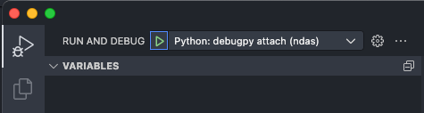
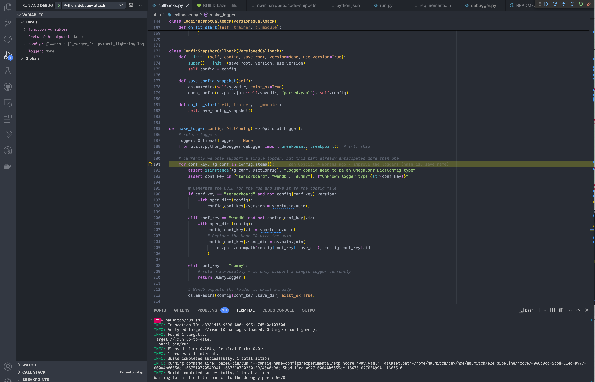

<!--
SPDX-FileCopyrightText: Copyright (c) 2023 NVIDIA CORPORATION & AFFILIATES. All rights reserved.
SPDX-License-Identifier: Apache-2.0
-->

# Debug Tool

This debugger module uses `debugpy` to enable breakpoint setting and interactive debugging of bazel targets within VSCode (and other editors)

## Basic usage:

1. Add the following launch configuration to the list of `configurations` in `${workspaceFolder}/.vscode/launch.json`:

   ```json
   {
     "name": "Python: debugpy attach",
     "type": "python",
     "request": "attach",
     "justMyCode": true,
     "connect": {
       "host": "localhost",
       "port": 5678
     },
     "pathMappings": [
       {
         "localRoot": "${workspaceFolder}",
         "remoteRoot": "${workspaceFolder}"
       }
     ]
   }
   ```

2. In a terminal, launch your bazel target as usual, e.g.:

   ```bash
   NUREC_DEBUGPY_ENABLED=true bazel run //:run -- --config-name=<config_name>
   ```

   Once the breakpoint is reached, a log message will show: `Waiting for a client to connect to the debugpy port: 5678`.

   Other flags that control the behavior are:

   - `NUREC_DEBUGPY_PORT` - sets which port to listen on (default `5678`)
   - `NUREC_DEBUGPY_LOG_DIR` - sets the directory to which debugpy logs (default none)
   - `NUREC_DEBUGPY_ALLOW_PORT_INCREMENT` - allows debugpy to listen at another port if `NUREC_DEBUGPY_PORT` is busy
   - `NUREC_DEBUGPY_BREAK_ON_CONNECTION` - adds a breakpoint immediately at the beginning of `import nurec`.

3. In VSCode, you can now connect the a debugger to the waiting debugpy port:

   

   Once the breakpoint is reached, you are dropped into the stack and can interactively debug.

   

## Advanced usage

### Adding the debug breakpoint to your own tagets

To have `debugpy` start a server that your IDE can attach to, certain code needs to be invoked. This is done automatically in `nurec/__init__.py` and controlled by `NUREC_DEBUGPY_ENABLED=true`. This means whenever you `import nurec.*` the debugger will attach early on in your run (including unit tests).

The instructions below are if you want to temporarily add the debugging hook to another target (e.g. a command-line tool under `apps/`).

1. add the target `//nurec/utils/debug:pylib` (use `//nurec/utils/debug:pylib_aux` for aux data generation contexts) as a dependency to your python BUILD target, e.g.:

   ```python
   py_library(
       name = "my_library",
       srcs = ["my_file.py"],
       deps = [
           "//nurec/utils/debug:pylib",   # TODO: remove from BUILD deps before merging
           "//other_dep:target",
           requirement("pip-package"),
       ],
   )
   ```

2. Import the debug module in your target that you want to debug i.e. any python file used by `my_library` above and set a breakpoint:

   ```python
   def my_func(a: float) -> None:
       """My function that I want to debug."""

       # Execution will pause on the following line and wait for a client to connect
       from nurec.utils.debug import breakpoint; breakpoint()  # fmt: skip
       ...
   ```

### Multiple debuggers simultaneously

The `breakpoint` function that is imported has an argument `allow_port_increment: bool`.

If set to `True`, it is possible to launch the debug task in vscode a second time, specifying the next port number. By default, `debugpy` uses 5678 - so creating a new entry in `launch.json` that simply uses port 5679 and running this will mean a second debug process attaches.

Changes made e.g. to local variables in each process are restricted to that individual debug session.

This can be very useful if reaching a debug point takes a long time e.g. if a specific condition is hit several epochs into training a model.

## Tips

- **Tip 1:** there is a debug console available to interactively use variables in the stack.

- **Tip 2:** you can move up and down the stack to check other variables.

- **Tip 3:** create up [a VSCode snippet](https://code.visualstudio.com/docs/editor/userdefinedsnippets), so you can quickly and easily import the code and set a breakpoint in a file:

  ```json
  {
    "Bazel debugpy": {
      "prefix": "bdebug-nurec",
      "body": [
        "from nurec.utils.debug import breakpoint; breakpoint()  # fmt: skip",
        "\"//nurec/utils/debug:pylib\", # TODO: remove from BUILD deps before merging"
      ],
      "description": "Import debugpy breakpoint utility"
    }
  }
  ```

  `Cmd+Shift+p` $\rightarrow$ `Snippets: Configure User Snippets` and select `python.json`.

  A file should be created under your user app data of VSCode.

  E.g. on Mac: `/Users/USERNAME/Library/Application Support/Code - Insiders/User/snippets/python.json`

## Resources

- [VSCode's documentation on debugging](https://code.visualstudio.com/docs/python/debugging)
- [Debugpy's Usage documentation](https://github.com/microsoft/debugpy#debugpy-cli-usage)
