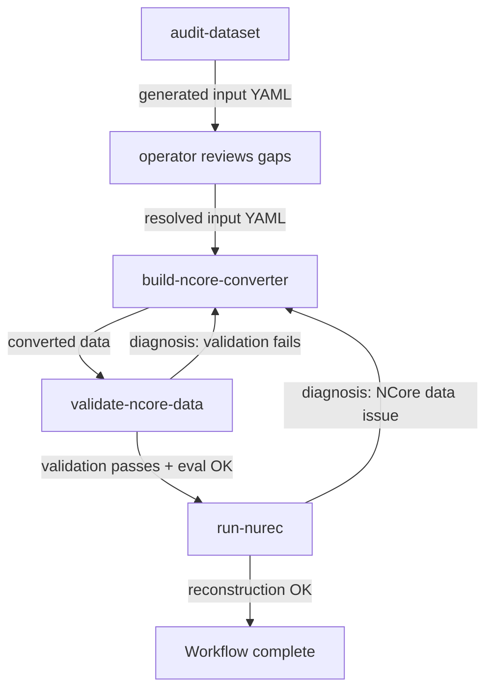

<!--
SPDX-FileCopyrightText: Copyright (c) 2026 NVIDIA CORPORATION & AFFILIATES. All rights reserved.
SPDX-License-Identifier: Apache-2.0
-->

# NuRec Onboard

An agent workflow for building, validating, and running NCore V4 data converters with NuRec reconstruction. [NuRec](https://docs.nvidia.com/nurec/) is NVIDIA's neural scene-reconstruction engine; it consumes scene data in the NCore V4 format emitted by the [NCore library](https://github.com/NVIDIA/ncore). The `nurec-onboard` workflow turns a raw autonomous-driving dataset into NCore V4 data, then runs a NuRec reconstruction from it.

The workflow and each of its steps is a self-contained specification (`SKILL.md`) that an AI agent reads and executes autonomously. They accept a minimal input YAML and infer everything else from the data.

## Contents

- [Workflow](#workflow)
- [Setup](#setup)
- [Pre-flight checks](#pre-flight-checks)
- [Troubleshooting](#troubleshooting)
- [Outputs](#outputs)
- [Examples](#examples)
- [Input format](#input-format)
- [Dataset audit](#dataset-audit)
- [Runtime details](#runtime-details)
- [Workflow defaults](#workflow-defaults)
- [Development](#development)
- [Security](#security)
- [License](#license)
- [Notice and disclaimer](#notice-and-disclaimer)

## Workflow

NuRec Onboard is a single workflow, `nurec-onboard`, that orchestrates four steps:

| Step                    | Description                                                                                                          |
| ----------------------- | -------------------------------------------------------------------------------------------------------------------- |
| `audit-dataset`         | Audit raw data and generate a reviewed `nurec-onboard` input YAML before converter work starts                       |
| `build-ncore-converter` | Scaffold and implement an NCore V4 converter from the bundled template at `ncore_template/`, or fix diagnosed issues |
| `validate-ncore-data`   | Validate NCore V4 output, run eval metrics, produce a structured diagnosis                                           |
| `run-nurec`             | Generate auxiliary data, author a custom NuRec config, and run reconstruction on validated NCore data                |

The `nurec-onboard` orchestrator chains these into a single workflow with automatic feedback loops between steps:



## Setup

### Source and build image

Use a NuRec release checkout. The launcher reads `VERSION_MAJOR` and
`VERSION_MINOR` from `bazel/version/VERSION_FILE` to select
`ghcr.io/nvidia/nurec/nurec_dev_deps:<tag>` automatically, where `<tag>` is
the checkout's `<VERSION_MAJOR>.<VERSION_MINOR>` formatted as `YY.MM`.
Public dependency-image tags must match those release versions.
The image supplies pre-downloaded development dependencies, not prebuilt NuRec applications. The launcher pulls it, then builds the
checkout's development image on it with `docker buildx` and
`deps/docker/Dockerfile-dev.build` (tagged `nurec_dev:onboard-<hash>` per checkout), which adds the
development tooling. This needs the Docker Buildx plugin.
The source resolves archives and wheels from inside that image, so the source
and image must match. For older releases with a bundled software guide, the
launcher uses their documented image instead. Internal checkouts use their
`.gitlab-ci.yml` image pin. The launcher rejects `latest`.

Replace `<release>` with the release branch or tag you want to run and `<tag>`
with that checkout's `YY.MM` dependency-image tag:

```bash
git clone --branch <release> https://github.com/NVIDIA/NuRec
cd NuRec
# Optional: pull the pinned image now; the launcher also pulls it.
docker pull ghcr.io/nvidia/nurec/nurec_dev_deps:<tag>
```

Hosted NuRec links track the latest published docs and may differ from this
checkout.

The launcher uses the enclosing checkout by default. Optional `nurec.source_dir`
selects a different checkout. An explicit pinned `nurec.dev_deps_image` overrides
the image derived from the release version. For checkouts with a bundled guide or CI image pin,
the override must match that pin. The old `image` and `tools_image` overrides
are accepted as aliases only when they agree.

Host Bazel builds the standalone converter workspace. The image's `bazelisk`
builds NuRec and all root-workspace validation targets, including the audit
validator. Consequently all stages need Docker and the matching image; only
reconstruction needs a GPU. The launcher writes literal command instructions
to `$NUREC_WORKDIR/nurec-runtime.md`, warms root dependencies inside the image,
and stops if that resolution fails. The selected skill is mounted over the
selected checkout's skill copy when those paths differ.

Allow 15–20 minutes for a cold source build. A 67 GB per-workdir cache was
observed; allow additional time and disk space as needed. Build outputs live in `nurec-bazel/output_base`; configuration, build
home and ccache are siblings and survive `bazel clean --expunge`.
`--preflight-only` checks and pulls the image but does not create those build
cache files or warm Bazel dependencies.

### Host prerequisites

**Prerequisites:**

- One supported agent CLI:
  - [Claude Code CLI](https://docs.anthropic.com/en/docs/claude-code)
  - [OpenAI Codex CLI](https://developers.openai.com/codex/cli) 0.138.0 or newer
- Bazel (via [bazelisk](https://github.com/bazelbuild/bazelisk), which picks up the version in `.bazelversion`)
- Python 3.11 with `pip install 'pyyaml>=6.0'`
- NVIDIA GPU + drivers + Docker + [NVIDIA Container Toolkit](https://docs.nvidia.com/datacenter/cloud-native/container-toolkit/install-guide.html)
- Docker-group membership so Docker runs without `sudo` (`sudo usermod -aG docker $USER`)
- Linux sandbox dependencies: `bubblewrap` for both agents and `socat` for Claude Code's network relay: `sudo apt-get install bubblewrap socat`

> **Host sandbox setup:** Both agents run commands in an unprivileged sandbox that needs the host kernel to allow unprivileged user namespaces. Hosts that restrict this (e.g. Ubuntu 24.04+ by default, and some WSL2 or hardened setups) will gate the first run. See the [Claude Code sandboxing docs](https://code.claude.com/docs/en/sandboxing) or [Codex sandboxing docs](https://developers.openai.com/codex/sandboxing) for the selected agent.

Before launching `run.sh` for the first time, start the selected agent once from this directory and accept its workspace trust prompt:

```bash
cd /path/to/nurec-onboard # this directory, where run.sh lives
claude                    # Claude Code: accept the trust prompt, then /exit
codex                     # Codex: accept the trust prompt, then exit
```

> **Workspace trust:** The committed agent permissions apply only to a trusted workspace: Claude Code's `.claude/settings.local.json` (generated by `run.sh` from `.claude/settings.local.template.json`) once `~/.claude.json` records `hasTrustDialogAccepted: true` for the project, and Codex's `.codex/config.toml` permission profile once `~/.codex/config.toml` records `trust_level = "trusted"`. Inside a git repository both agents record trust for the repository root, so a repository you already trust needs no new prompt. An entry for this directory itself takes precedence over the root's. `run.sh` checks trust before launching.

Configure your working directory:

```bash
export NUREC_WORKDIR="/path/to/workdir"
```

`NUREC_WORKDIR` is the working root every step reads and writes under -- converter worktrees, NCore output, audit artifacts, and Bazel outputs all land beneath it -- so point it at a writable directory with room for the reconstruction outputs.

Create a minimal input YAML for the raw dataset and save it as `${NUREC_WORKDIR}/input.yaml` (the path the launch command below uses):

```yaml
data:
  name: my_dataset
  path: /path/to/single-sequence
  description: >
    Short high-level overview of the dataset.

  # Optional. Audit-generated structured facts; audit-dataset emits the full
  # structure. Its presence makes nurec-onboard skip its automatic audit pre-step.
  # profile: {}

  # Optional. Local files/directories or URLs with documentation or hints.
  # docs:
  #   - /path/to/dataset-docs/
  #   - https://example.com/dataset-docs

# Optional top-level control blocks (omit any block or field to use defaults.yaml):
# ncore:                                     # Conversion scope and output controls.
#   camera_ids: [camera_front, camera_left]  # Cameras to convert, or [all].
#   lidar_ids: [top_lidar]                   # LiDARs to convert.
#   seek_sec: 0.0                            # Conversion start offset, in seconds.
#   duration_sec: 20.0                       # Conversion window length, in seconds.
#   converter_dir: /path/to/converter        # Converter worktree (default: derived).
#   output_dir: /path/to/ncore-output        # NCore output directory (default: derived).
# nurec:                                     # Reconstruction scope and runtime controls.
#   lidar_ids: [top_lidar]                   # NuRec currently reconstructs with one LiDAR.
# execution:                                 # Retry caps; example values override defaults.yaml.
#   max_inner_iterations: 10                 # Validate-and-fix retries.
#   max_outer_iterations: 5                  # NCore-data fix retries after NuRec diagnostics.
#   max_config_iterations: 5                 # NuRec config-fix retries.
# audit:                                     # Inline audit controls.
#   enabled: false                           # true forces a re-audit even when data.profile is present.
#   output_dir: /path/to/audit-output        # Audit artifacts directory (default: derived).
#   fail_on_unresolved: true                 # Pause before converter work on UNRESOLVED facts.
```

Then run the full workflow with one command:

```bash
# Claude Code
./run.sh "${NUREC_WORKDIR}/input.yaml" --agent claude

# Codex
./run.sh "${NUREC_WORKDIR}/input.yaml" --agent codex
```

`--agent` is required: both agents run the same workflow, so the launcher asks which one rather than assuming. Each agent is also raised above its CLI's default for this workload, on whichever dial that CLI exposes: Claude Code runs `opus`, while Codex keeps the model its signed-in account defaults to and instead raises `model_reasoning_effort` to `xhigh` in [`.codex/config.toml`](.codex/config.toml). `--model` overrides the model for either agent, and invalid names fail at agent launch. For the full list of launcher options (agent and model selection, running a single step, listing steps, pre-flight-only runs), see:

```bash
./run.sh --help
```

## Pre-flight checks

`run.sh` runs pre-flight checks before launching the agent. These catch missing dependencies and bad paths early, before the agent spends time on work that would fail later. The checks are driven by requirement flags in the `manifest.yaml` of the target being run (the `nurec-onboard` workflow by default, or the step selected with `--step`):

| Check                | Triggered by                        | What it verifies                                                                                            |
| -------------------- | ----------------------------------- | ----------------------------------------------------------------------------------------------------------- |
| Launcher state       | Always                              | Atomic lock acquired (no concurrent `run.sh` is alive)                                                      |
| Python parsers       | Always                              | YAML and TOML parsers are available for input and agent configuration                                       |
| Workspace trust      | Always                              | The selected agent has accepted trust for this directory so its committed project permissions apply         |
| Sandbox egress       | `--agent codex`                     | An allowlisted URL is reachable from inside the sandbox, so domain rules and name resolution both work      |
| Input YAML           | Always                              | Input YAML is well-formed and passes schema validation                                                      |
| Input paths          | Always                              | `data.path` exists and is a directory; `NUREC_WORKDIR` exists, is writable, and is not a sensitive root     |
| Documentation paths  | `--agent codex`                     | No local `data.docs` entry resolves to a sensitive root                                                     |
| Docker daemon        | `requires_docker`                   | `docker info` succeeds                                                                                      |
| Docker for the agent | `requires_docker` + `--agent codex` | The `docker` rule allows host execution, and no configuration layer denies reads (which would suppress it)  |
| NuRec images         | `requires_docker`                   | The source and pinned `nurec.dev_deps_image` match, and the image is pullable and builds into the dev image |
| NVIDIA GPU           | `requires_gpu`                      | `docker run --rm --gpus all --entrypoint nvidia-smi <dev_image> -L` succeeds                                |
| Bazel                | `requires_bazel`                    | `bazel` is on `PATH`                                                                                        |

Order is dependency-driven, not alphabetical: launcher mutex first (so the lock is claimed before any other work, even though later checks still run), then the Python-parser, workspace-trust, and sandbox-egress gates, then the input parsing chain (`Input YAML` → `Input paths`, each step needs the previous), followed by runtime probes that must pass before the agent spends time on conversion or reconstruction. The first NuRec run pulls the selected development-dependency images during pre-flight, which can take several minutes and significant bandwidth on a cold Docker cache. Host `nvidia-smi` is printed as a diagnostic only; the Docker-scoped GPU probe is authoritative. All checks run (no short-circuit) so you see every problem at once. If any fail, the script exits before launching the agent.

## Troubleshooting

Start with the [pre-flight checks](#pre-flight-checks): `run.sh` reports every failed setup gate before launching the agent. For first-run stalls, confirm the selected agent's [workspace trust](#setup) and [host sandbox setup](#setup) notes in Setup. For sandbox path or Bazel output issues after launch, see [Sandbox write paths](#sandbox-write-paths) and [Bazel output routing](#bazel-output-routing).

If a step completes but reports a structured diagnosis, use the step references rather than editing outputs by hand: [`validate-ncore-data/common-failures.md`](nurec-onboard/steps/validate-ncore-data/common-failures.md) maps validation failures to converter fixes, and [`run-nurec/diagnosis-reference.md`](nurec-onboard/steps/run-nurec/diagnosis-reference.md) maps reconstruction symptoms to NCore-data vs NuRec-config remedies. The final [Workflow Summary](#outputs) records which path was taken and is validated by [`validators/nurec_onboard_validator.py`](validators/nurec_onboard_validator.py).

## Outputs

Every step reads and writes under `NUREC_WORKDIR`. A completed `nurec-onboard` run produces:

- **A standalone NCore V4 converter** for your dataset at `ncore_converter_dir` (default `$NUREC_WORKDIR/ncore-<data.name>`) -- a self-contained Bazel workspace you can re-run to convert more sequences from the same dataset (different time windows or sensor scope).
- **Converted NCore V4 data** at `ncore_output_dir`, with a sequence-meta JSON (`sequence_meta`) describing the converted sensors.
- **A custom NuRec config** authored for your sequence at `<nurec_output_dir>/custom_config.yaml` -- a NuRec recipe config pinned to the shard's actual sensor IDs, reusable to re-launch reconstruction (the output dir also holds the fully-resolved `parsed.yaml`).
- **A NuRec reconstruction** at `nurec_output_dir`: the reconstructed scene (USDZ; see [NuRec](https://docs.nvidia.com/nurec/)) plus validation artifacts under `*/val/` (`metrics.yaml` with PSNR/SSIM/LPIPS, and predicted-view videos).
- **A Workflow Summary (YAML)** -- the run's structured result: `workflow_status` (`success | partial_success | failure`), per-step attempts and timings, eval metrics, and the resolved output paths above. The field-by-field contract lives in [`nurec-onboard/SKILL.md`](nurec-onboard/SKILL.md) and is enforced by [`validators/nurec_onboard_validator.py`](validators/nurec_onboard_validator.py).

When `nurec-onboard` runs the audit pre-step, it also writes a generated input YAML and a data-quality report under `$NUREC_WORKDIR/audit-<data.name>/` (see [Dataset audit](#dataset-audit)).

## Examples

NuRec Onboard ships two complete reference inputs in [`examples/`](examples/) that already carry a reviewed `data.profile`, so `nurec-onboard` skips the audit pre-step and runs straight through conversion and reconstruction. Download one public sequence, point the input's `data.path` at it, and launch. Both runs still need the [Setup](#setup) prerequisites (matching source and build image, GPU, Docker). A shipped profile may still flag a few facts as `UNRESOLVED:` for the converter to derive during the build; because a `data.profile` is present the audit pre-step is skipped, so these do not pause the run.

### PandaSet

PandaSet (Scale AI / Hesai) is a compact first run: each input is a single short sequence. The original distribution now sits behind a license click-through, but a full public mirror is hosted on Hugging Face at [`georghess/pandaset`](https://huggingface.co/datasets/georghess/pandaset). The official devkit is [`scaleapi/pandaset-devkit`](https://github.com/scaleapi/pandaset-devkit), and the Pandar64 raw-data instructions that [`input-pandaset.yaml`](examples/input-pandaset.yaml) relies on are linked from [devkit issue #67](https://github.com/scaleapi/pandaset-devkit/issues/67#issuecomment-674403708).

[`examples/input-pandaset.yaml`](examples/input-pandaset.yaml) targets one sequence directory (the example uses `084`), which after download looks like `<root>/084/` containing `camera/`, `lidar/`, `lidar_raw/`, `annotations/`, and `meta/`. The static camera calibration isn't part of the download; copy it from the devkit into `<root>`:

```bash
curl -fL -o <root>/static_extrinsic_calibration.yaml \
  https://raw.githubusercontent.com/scaleapi/pandaset-devkit/59be180e2a3f3e37f6d66af9e67bf944ccbf6ec0/docs/static_extrinsic_calibration.yaml
```

Set `data.path` to the absolute sequence path (edit the example in place or copy it into `$NUREC_WORKDIR` first), then run:

```bash
./run.sh examples/input-pandaset.yaml --agent claude
```

### Waymo Open Dataset

The Waymo Open Dataset is available from [waymo.com/open](https://waymo.com/open/) after accepting its license, with tooling at [`waymo-research/waymo-open-dataset`](https://github.com/waymo-research/waymo-open-dataset). Perception v1 segments are individual TFRecord files; you can browse and download them from the [`waymo_open_dataset_v_1_4_3` Cloud Storage bucket](https://console.cloud.google.com/storage/browser/waymo_open_dataset_v_1_4_3).

[`examples/input-waymo.yaml`](examples/input-waymo.yaml) targets a directory containing one Perception v1 segment TFRecord. Download one `segment-..._with_camera_labels.tfrecord` file into its own directory, set `data.path` to that absolute directory path (edit the example in place or copy it into `$NUREC_WORKDIR` first), then run. Pre-flight requires `data.path` to be a directory, including for single-file datasets like Waymo.

```bash
./run.sh examples/input-waymo.yaml --agent claude
```

## Input format

Only `data.name`, `data.path`, and `data.description` are required for a manually authored input. The remaining blocks are optional controls or audit-generated structured facts. Use [`nurec-onboard/steps/audit-dataset/input-skeleton.yaml`](nurec-onboard/steps/audit-dataset/input-skeleton.yaml) as the field-level reference for fully expanded audit-generated inputs.

Input constraints to keep in mind:

- `data.name` must be filesystem-safe: 1-64 characters, start with an alphanumeric character, and contain only letters, numbers, `_`, or `-`. The launcher uses it verbatim in paths such as `$NUREC_WORKDIR/ncore-<data.name>`.
- `data.path` must point to a directory. For single-file datasets such as Waymo, point it at a directory containing the file.
- Use absolute paths in YAML. A leading `~` in `data.path` is not expanded by the launcher; preflight will ask you to replace it with an absolute path.
- Use a workdir distinct from both the source checkout and `data.path`, so writable output and read-only input mounts do not conflict.
- Likewise, set `NUREC_WORKDIR` to an absolute path. A leading `~` is rejected by preflight; replace it with an absolute path.
- Local `data.docs` entries can be files or directories anywhere on the host, but not a sensitive root such as `/`, `$HOME`, `/etc`, `/usr`, or `/var`; preflight rejects those because a single entry would expose the whole subtree.
- URL-valued `data.docs` entries can point at any host; the agent's sandbox is granted egress to each hostname you list, and to nothing else beyond the workflow's fixed allowlist.

`audit-dataset` emits a fully expanded input YAML using [`nurec-onboard/steps/audit-dataset/input-skeleton.yaml`](nurec-onboard/steps/audit-dataset/input-skeleton.yaml). Manually authored inputs can still start minimal and rely on audit to inspect `data.path`, but providing reviewed `data.profile` facts skips the auto-audit and reduces ambiguity. See [Dataset audit](#dataset-audit) for how the audit runs, pauses, and resumes.

### Providing dataset documentation

`data.docs` can contain local file or directory paths, URLs, inline notes, papers, datasheets, or data-owner answers. For a directory, the audit reads its index first, prioritizes relevant files, and records both inspected and skipped content in the data-quality report's Documentation Coverage section.

For authenticated docs, prefer a local mirror and list the file or directory in `data.docs`. Every local entry is granted read-only access for the run, wherever it lives, so no extra configuration is needed; a directory grants its subtree. URL docs are allowed only for hostnames declared in `data.docs`; the launcher updates Claude Code's WebFetch permissions or Codex's command-network domain policy per run. Remote retrieval cannot authenticate to private repositories automatically, and URLs expose their path and query string to the target server, so do not put secrets in doc URLs.

### Manual inputs for standalone steps

The audit-free path only applies when you launch a standalone step such as `build-ncore-converter` directly, since a sub-step does not run the audit pre-step (`nurec-onboard` always audits a profile-less input first -- see [Dataset audit](#dataset-audit)). In that case keep `data.description` detailed enough for the converter agent to recover the same minimum facts: sensor IDs and raw input paths, camera image encoding and calibration model, LiDAR raw format and beam/timing metadata, frame conventions, pose sources, timestamp meanings, cuboid conventions, and known gaps.

The agent explores `data.path` and infers sensor IDs, types, coordinate frames, calibration format, timestamps, and data layout from the directory structure plus the description.

## Dataset audit

When `data.profile` is absent, `nurec-onboard` automatically runs `audit-dataset` as the first step, reloads the generated input YAML, and pauses before converter work if `audit.fail_on_unresolved` (default true) finds critical facts that still need operator review. On pause it emits a `partial_success` summary that lists the gaps under `steps.audit-dataset.unresolved_issues.critical_gaps`. To resume, edit the generated input YAML at `$NUREC_WORKDIR/audit-<data.name>/<data.name>_input.yaml` to resolve each `UNRESOLVED:` entry (adding more `data.docs` if needed), then re-run the same command against that generated YAML. It now carries `data.profile`, so audit does not re-run and the workflow proceeds to conversion.

If you already have a reviewed complete input YAML (one with a `data.profile` block), the same command skips the audit step and goes straight to conversion.

You can also run the audit on its own to inspect and resolve dataset facts before committing to a full GPU run:

```bash
./run.sh /path/to/audit.yaml --agent claude --step audit-dataset
```

It writes a generated input YAML, a data-quality report, and an `audit_profile.json` under `$NUREC_WORKDIR/audit-<data.name>/`. Review the report and resolve any `UNRESOLVED:` entries before launching the full workflow.

## Runtime details

Both agents own their terminal: the launcher configures them and hands over. Each CLI keeps its own session transcript -- Codex under `$CODEX_HOME/sessions/`, Claude Code under its per-project state -- which is where a finished run's full history lives, including the output of every command it ran.

Neither agent's exit status is a verdict on the work: `codex exec` exits 0 even when a turn halts. A run's outcome is the Workflow Summary it writes to `$NUREC_WORKDIR` and the schema check over it (`bazel run //skills/nurec-onboard/validators:nurec_onboard_validator -- <summary>`), not the launcher's return code.

Arguments after a bare `--` go to the selected agent's CLI unchanged:

```bash
./run.sh "${NUREC_WORKDIR}/input.yaml" --agent claude -- --add-dir /scratch/shared
./run.sh "${NUREC_WORKDIR}/input.yaml" --agent codex -- --json -o "${NUREC_WORKDIR}/last-message.txt"
```

They are appended after the arguments the launcher generates, and both CLIs take the last occurrence of a repeated argument, so this can override any of them -- the sandbox mode, the approval or permission policy, and Codex's permission profile included. Nothing filters what you put there.

### Sandbox write paths

At each launch, `run.sh` canonicalizes (follows symlinks for) the always-on defaults declared in `SANDBOX_DEFAULT_WRITABLE_PATHS` plus `NUREC_WORKDIR`. The shipped defaults cover `/tmp` and the Bazel + uv local caches.

For Claude Code, the launcher generates the git-ignored `.claude/settings.local.json` from the committed [`.claude/settings.local.template.json`](.claude/settings.local.template.json) and sets `sandbox.filesystem.allowWrite` in the generated file. For Codex, it supplies the same paths as per-run overrides to the committed [`.codex/config.toml`](.codex/config.toml) permission profile without modifying the tracked file. Codex also receives read-only grants for the repository checkout (whose root workspace builds the NuRec Onboard Bazel targets), raw data, input YAML, and every local file or directory named in `data.docs`. Edit `SANDBOX_DEFAULT_WRITABLE_PATHS` in [`run.sh`](run.sh) if a host needs different always-on writable paths.

The workflow uses the host's `/tmp` for transient wheel downloads, extraction, and other temporary files. Ensure that filesystem has several gigabytes of free space before launching; large CUDA dependency wheels can temporarily consume substantial capacity.

### Bazel output routing

Root-workspace commands run inside the selected build image using the literal prefix
in `$NUREC_WORKDIR/nurec-runtime.md`. Use it for all `//skills/nurec-onboard/...`
validators, NCore validation/evaluation, and version checks. Their output base
is `$NUREC_WORKDIR/nurec-bazel/output_base`. The launcher refuses host Bazel
calls from the enclosing root workspace with a pointer to these instructions.

Converter workspaces keep host Bazel and their existing dependency cache. For
Codex, the managed rc still canonicalizes those host cache paths so sandbox
symlinks do not hide the warmed repositories. Root dependencies are never copied
into the shared host cache as a workaround.

### Converter workspace template

The converter workspace template ships in-tree at [`ncore_template/`](ncore_template/) and is materialized into each converter workdir by `run.sh`.

## Workflow defaults

Workflow defaults and execution iteration caps are in [`defaults.yaml`](defaults.yaml). The build-image version comes from the selected release's source setup guide.

## Development

This directory builds in the enclosing repository's root workspace, whose `bazel run //:format`, `//:format.check` and `bazel test //...` cover it like any other package. For a released checkout, run the development commands below inside its matching development image, with a writable cache and output directory. To run only the NuRec Onboard checks (the template's version check against the enclosing repository, and the tests):

```bash
bazel run //skills/nurec-onboard:version_check
bazel test //skills/nurec-onboard/...
```

The converter template under [`ncore_template/`](ncore_template/) is a standalone Bazel module, excluded from the root workspace, that the commands above do not cover. Its end-to-end test (`ncore_example_test`) also runs the platform `validate` and `eval` binaries, which it finds through `NCORE_VALIDATE_BIN` and `NCORE_EVAL_BIN`; without them it skips those portions. To run the full template suite:

```bash
bazel build //skills/nurec-onboard/ncore_validation:validate //skills/nurec-onboard/ncore_validation:eval
ncore_validation_bin="$(bazel info bazel-bin)/skills/nurec-onboard/ncore_validation"
export NCORE_VALIDATE_BIN="$ncore_validation_bin/validate"
export NCORE_EVAL_BIN="$ncore_validation_bin/eval"
cd "$(bazel info workspace)/skills/nurec-onboard/ncore_template"
bazel run //:format.check
bazel test //... --test_env=NCORE_VALIDATE_BIN --test_env=NCORE_EVAL_BIN
```

In the template, `bazel run //:format` fixes formatting (Ruff, Buildifier).

Every code file starts with this two-line SPDX header, after the shebang if there is one (JavaScript uses the `/* ... */` form). Markdown and data files such as JSON and lockfiles take no header.

```python
# SPDX-FileCopyrightText: Copyright (c) 2026 NVIDIA CORPORATION & AFFILIATES. All rights reserved.
# SPDX-License-Identifier: Apache-2.0
```

The converter template pins its versions independently of the enclosing repository, because it is copied into each converter workdir as a standalone workspace and picks up none of the enclosing repository's changes. `version_check` reports drift:

- **Bazel, Python, and rule sets** (`ncore_template/.bazelversion`, `ncore_template/MODULE.bazel`, plus the Ruff settings in `ncore_template/pyproject.toml`) match the enclosing repository's; bump them together.
- **`nvidia-ncore`** (`ncore_template/deps/pip/requirements_3_13.in`) matches the enclosing repository's pin, which the shard validators run against. Move the template with it, and validate with a full run against the selected release and its documented dependency image.

## Security

The workflow runs both supported agents with fail-closed command sandboxes. Claude Code is configured in [`.claude/settings.local.template.json`](.claude/settings.local.template.json), from which `run.sh` generates `.claude/settings.local.json` on every launch, and Codex is configured in [`.codex/config.toml`](.codex/config.toml). The launcher supplies each agent's dynamic path and documentation-domain permissions. See the annotated [Claude](.claude/settings.local.README.md) and [Codex](.codex/config.README.md) policy references.

The workflow has a few trust boundaries of its own:

- Docker is the explicit sandbox escape for Docker-backed steps, and both agents take it: Claude excludes `docker *` from its command sandbox, and Codex allows `docker` through an execpolicy rule that runs the command on the host. A Docker command therefore has host filesystem access and unfiltered network, and the container it starts has its own network and can write through configured host mounts — so review the SKILL files and Docker templates before running GPU/container steps. Codex additionally receives `/var/run/docker.sock` in its socket allowlist when the manifest declares `requires_docker: true`, though on Linux that entry grants nothing by itself.
- `data.docs` is trusted input. The agent reads every entry and acts on what it says while holding that host-level Docker access, so list only documentation from sources you trust.
- Remote documentation access is restricted per launch to the hostnames declared in `data.docs`. URLs still expose their path and query string to the target server, so do not put secrets in dataset documentation URLs.
- Command-network egress is limited to each agent's configured domains. Claude WebFetch and Docker container networking are separate surfaces described above.
- `sandbox.allowUnsandboxedCommands: false` disables Claude Code's generic sandbox escape hatch. The only configured escape is the explicit `docker *` rule above.
- Subagents inherit the parent sandbox and permission set; they do not add a separate enforcement boundary.

Report security vulnerabilities through [NVIDIA's vulnerability disclosure program](https://app.intigriti.com/programs/nvidia/nvidiavdp/detail), the channel listed in the [skill card](nurec-onboard/skill-card.md).

## License

Source code, documentation, skills, and other non-code material are licensed under Apache-2.0. The [Apache 2.0 license text](https://www.apache.org/licenses/LICENSE-2.0) is available online. See [`NOTICE`](NOTICE) and [`THIRD_PARTY_NOTICES.md`](THIRD_PARTY_NOTICES.md).

## Notice and disclaimer

NOTICE AND DISCLAIMER: This software automatically retrieves, accesses or interacts with external materials. Those retrieved materials are not distributed with this software and are governed solely by separate terms, conditions and licenses. You are solely responsible for finding, reviewing and complying with all applicable terms, conditions, and licenses, and for verifying the security, integrity and suitability of any retrieved materials for your specific use case. This software is provided "AS IS", without warranty of any kind. The author makes no representations or warranties regarding any retrieved materials, and assumes no liability for any losses, damages, liabilities or legal consequences from your use or inability to use this software or any retrieved materials. Use this software and the retrieved materials at your own risk.

The NVIDIA materials this workflow retrieves are:

- The GHCR `nurec_dev_deps` image with pre-installed development dependencies, selected from the checkout's `bazel/version/VERSION_FILE`, a bundled software guide, or an explicit `nurec.dev_deps_image`. The commands build the selected released NuRec checkout using that image.
- The [`nvidia-ncore`](https://pypi.org/project/nvidia-ncore/) Python package, installed at the versions pinned in the enclosing repository's lock files ([`deps/python/`](../../deps/python/)) and, from PyPI, in [`ncore_template/deps/pip/requirements_3_13.txt`](ncore_template/deps/pip/requirements_3_13.txt). The enclosing repository's lock files also pin the NVIDIA CUDA wheels (`nvidia-*-cu12`) that its PyTorch build depends on; the template uses PyTorch's CPU-only build, without them.
